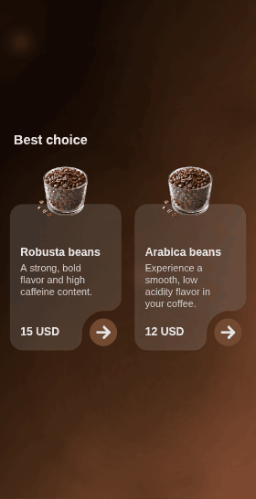
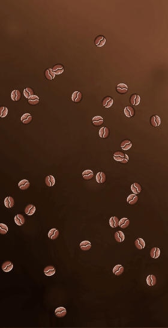
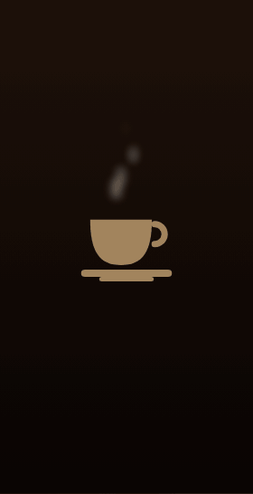
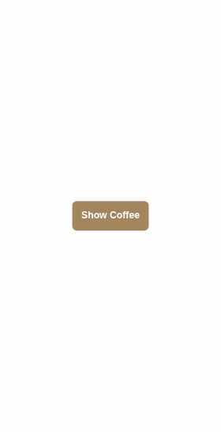
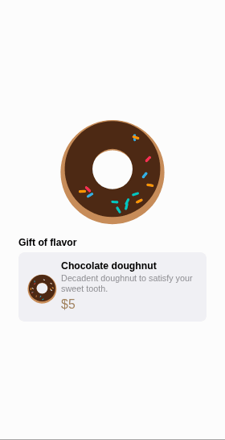

# Coffee Animations

A SwiftUI portfolio of small, self-contained animation showcases built around a coffee theme. The app opens on a gallery; each entry pushes a full-screen demo.


## Previews

<table>
  <tr>
    <td align="center"><br><b>Coffee Shop</b></td>
    <td align="center"><br><b>Floating Beans</b></td>
    <td align="center"><br><b>Coffee Art Background</b></td>
  </tr>
  <tr>
    <td align="center"><br><b>Rising Steam</b></td>
    <td align="center"><br><b>Reveal Cup</b></td>
    <td align="center"><br><b>Doughnut Card</b></td>
  </tr>
</table>

<sub>Previews are canvas re-creations generated from the SwiftUI source (same sizes, colors, timings and image assets). Fonts and SF Symbols are approximated, and the tap marker in Floating Beans is only there to show where the tap happens. See <a href="docs/previews/tools/README.md"><code>docs/previews/tools</code></a> to regenerate them.</sub>

## Showcases

| Demo | What it shows |
|------|---------------|
| **Coffee Shop** | Animated storefront: pulsing gradient backdrop with glass (`.ultraThinMaterial`) product cards over a custom `LShape`. |
| **Floating Beans** | 50 beans drifting across the screen. Tap to scatter them off-screen with a fade, then a fresh batch spawns in. |
| **Coffee Art Background** | A looping linear-gradient drift with blurred, gently pulsing coffee-toned circles. |
| **Rising Steam** | Wisps of steam rise from a cup, swaying and fading out as they climb. |
| **Reveal Cup** | Button-triggered scale transition revealing a coffee cup. |
| **Doughnut Card** | A chocolate-glazed doughnut with sprinkles that slowly spins and bobs, on top of a product card. |

## Requirements

- Xcode 16 or later
- iOS 18.1+ deployment target (builds in the Swift 5 language mode)

## Build & run

```bash
git clone https://github.com/A-bv/CoffeeBeansAnimationApp.git
cd CoffeeBeansAnimationApp
open CoffeeBeansAnimationApp.xcodeproj
```

Pick an iOS simulator (e.g. iPhone 17 Pro) and press **⌘R** to run. From the command line:

```sh
xcodebuild \
  -project CoffeeBeansAnimationApp.xcodeproj \
  -scheme CoffeeBeansAnimationApp \
  -destination 'platform=iOS Simulator,name=iPhone 17 Pro' \
  build
```

## Layout

```
CoffeeBeansAnimationApp/
├── CoffeeApp.swift                 # @main entry → AnimationGalleryView
├── Gallery/
│   ├── AnimationGalleryView.swift  # Scrollable list of showcases (NavigationStack)
│   └── AnimationDemo.swift         # Enum model: one case per showcase
├── CoffeeBeansAnimationView.swift  # "Floating Beans" demo
├── CoffeeHomeView.swift            # "Reveal Cup" demo
└── Home/
    ├── MainView.swift              # "Coffee Shop" demo (background + choices)
    ├── CoffeeArtBackgroundView.swift
    ├── CoffeeChoiceView.swift
    ├── CoffeeBeanOption.swift
    ├── DoughnutView.swift
    └── LShape.swift                # Custom L-shaped card backdrop
```

## Adding a new animation

The gallery is driven by the `AnimationDemo` enum, so adding a showcase is two steps:

1. Add a `case` to `AnimationDemo` (and a `subtitle` + SF Symbol `symbol`).
2. Return your view from the `destination` switch.

`AnimationGalleryView` renders every case automatically via `CaseIterable` — no list editing required.

## Conventions

- Positions in the animated views are stored as **fractions (0...1)** of the
  container and resolved through `GeometryReader`, so demos are
  resolution-independent and behave correctly on iPad / multi-window (no
  `UIScreen.main`).
- Randomized layouts are generated **once** into a model array, never inline in
  `body`, to keep the scene stable across re-renders.
